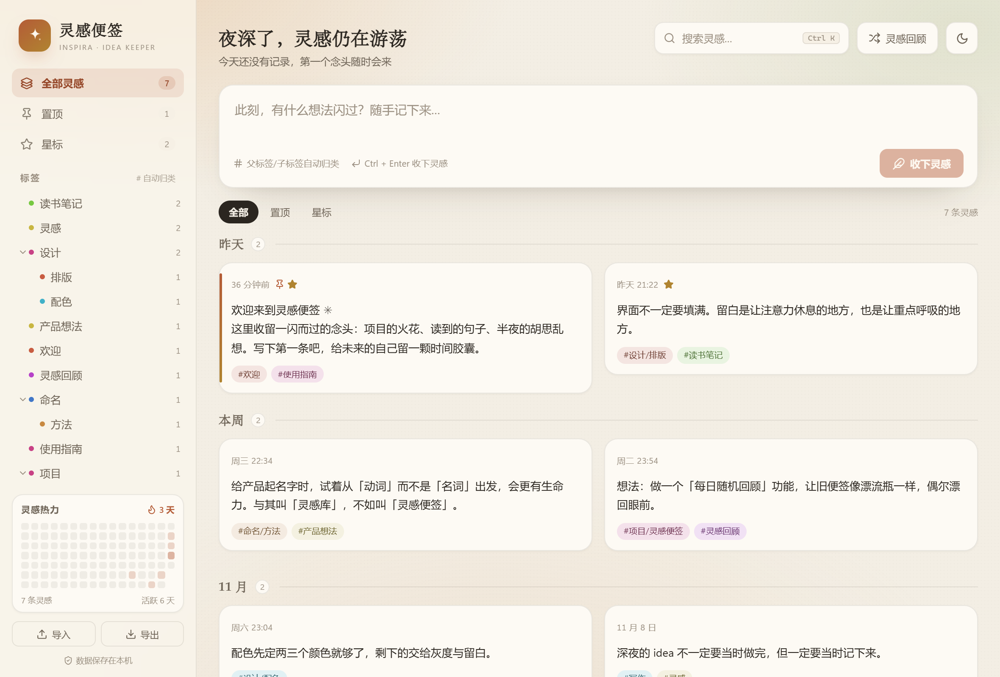
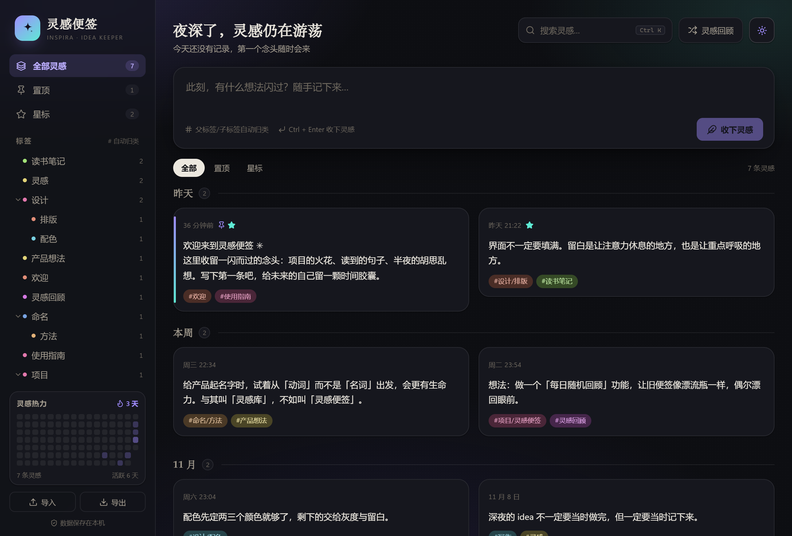

# 灵感便签 · Inspira

> 把一闪而过的念头，留成给未来的时间胶囊。

灵感便签是一款本地优先的桌面灵感捕捉应用。它不要求你先建项目、先想分类：让记录先发生，`#标签` 会从正文中自动提取；之后按日期、标签，或在随机回顾里重新遇见这些念头。

| 纸 · 日间 | 夜 · 深色 |
| --- | --- |
|  |  |

## 功能

- **随手记录**：顶部速记框自动增高，`Ctrl/⌘ + Enter` 立即收下；输入时实时预览解析出的标签。
- **多级标签**：支持 `#设计`、`#设计/排版` 这样的父子标签，侧栏生成带计数的标签树；选中父标签会同时筛选整棵子树。
- **日期瀑布流**：按「今天 / 昨天 / 本周 / 月份」分组，两列卡片自适应排布；置顶内容在组内优先，但不会打乱日期顺序。
- **查找与视角**：全部、置顶、星标三个视角；搜索同时命中正文与标签，并以安全的文本切片高亮结果。
- **随机回顾**：从旧便签中随机抽一条重逢，优先选择一天以前的记录；可以「换一条」，不会连续抽到同一条。
- **灵感热力**：侧栏展示最近 16 周的记录密度、活跃天数与连续天数。
- **编辑与撤销**：双击卡片进入编辑；删除后 6 秒内可在提示条中撤销，避免误删。
- **纸与夜双主题**：首次启动跟随系统主题，之后记住选择；两套配色、阴影与热力色都做了独立校准。
- **本地优先**：便签保存在本机，不联网；支持 JSON 导出备份，导入时按 id 合并、以导入内容为准，不静默删除现有记录。
- **桌面细节**：安全 preload 桥、系统文件对话框、与主题匹配的窗口底色、最小 960 × 640 的窗口约束、`prefers-reduced-motion` 降级。

## 快捷键

| 快捷键 | 行为 |
| --- | --- |
| `Ctrl/⌘ + N` | 聚焦速记框 |
| `Ctrl/⌘ + K` | 聚焦搜索框 |
| `Ctrl/⌘ + Enter` | 在速记框或编辑器中保存 |
| `Esc` | 关闭编辑器或回顾弹窗 |

## 快速开始

要求 Node.js 20+。

```bash
npm install
npm run dev        # 启动 Electron 桌面窗口
npm run dev:web    # 只启动渲染层，浏览器访问 http://localhost:5180
```

其他命令：

```bash
npm run build      # 构建 main / preload / renderer 到 out/
npm start          # 预览构建产物
npm run typecheck  # TypeScript 类型检查
npm test           # Vitest 逻辑测试
```

## 标签写法

```text
给「灵感便签」加一个随机回顾 #产品/灵感便签 #动效
```

- 标签以 `#` 开头，支持中文、字母、数字、`_` 与 `-`，用 `/` 表示层级。
- 标签从正文解析而来，正文是唯一事实来源；重复标签按大小写不敏感去重。
- 点击侧栏父标签会包含其全部子标签下的便签。
- 标签颜色由路径哈希到固定色板，同一路径在亮暗主题下保持同一色相。

## 数据与备份

- 便签与主题保存在渲染层的 `localStorage`（键为 `inspira.notes.v1`、`inspira.theme`），位于 Electron 用户数据目录；本机验证路径为 Windows 的 `%APPDATA%\\灵感便签`。
- 侧栏「导出」会生成包含 `app`、`version`、`exportedAt` 与 `notes` 的 JSON 文件；「导入」限制 5 MB，并在应用中按 id 合并。
- 首次启动会写入一组可删除的示例便签，用来展示标签、置顶、星标与热力图；清空本地存储后才会重新生成。

## 技术栈

| 层 | 选型 |
| --- | --- |
| 桌面容器 | Electron 32 + electron-vite 2 |
| UI | React 18 + TypeScript 5 |
| 动效 | framer-motion 11 |
| 图标 | lucide-react |
| 构建 / 测试 | Vite 5 + Vitest 2 |

## 目录结构

```text
docs/
├─ DESIGN.md                 设计决策与视觉规范
└─ screenshots/              双主题展示截图
resources/
└─ icon.png                  窗口与任务栏图标（由品牌 SVG 导出）
src/
├─ main/index.ts            Electron 主进程：窗口、主题底色、导入导出 IPC
├─ preload/index.ts          contextBridge 暴露最小化的 notesApi
└─ renderer/
   ├─ index.html             注入主题脚本，避免首屏闪烁
   ├─ public/favicon.svg
   └─ src/
      ├─ components/         侧栏、标签树、热力图、速记框、卡片、弹窗、提示条
      ├─ lib/                标签、日期分组、筛选、存储、备份、主题、桌面桥
      ├─ store/notes.tsx     便签状态、撤销栈与 200ms 防抖持久化
      ├─ styles/             设计 token、基础样式与应用布局
      ├─ App.tsx
      ├─ types.ts
      └─ main.tsx
```

## 设计说明

完整的视觉与交互决策记录在 [docs/DESIGN.md](docs/DESIGN.md)：纸与夜的 token 对照、布局断点、动效节奏、组件职责，以及「导入合并而非覆盖」「删除后内联撤销」等取舍。

## 验证情况

- `npm run typecheck` 通过，`npm test` 的 9 项逻辑测试全部通过。
- 已在 960 × 700、1180 × 800、1440 × 900 三种真实视口检查双主题与两列布局，并走查新增、搜索、标签筛选、随机回顾、编辑、删除与撤销流程。
- 已启动构建后的 Electron 窗口验证应用名、1180 × 800 窗口、preload 桥与双主题切换；通过测试桩接管系统对话框，验证导出写盘、导入读回与 5 MB 上限均正常。

## 参考与致谢

产品形态参考了 [Memos](https://github.com/usememos/memos) 的时间流与内联标签、[flomo](https://flomoapp.com) 的卡片记录与回顾思路；本项目在其基础上重做了面向桌面端的信息架构与视觉系统。
